# Road anomaly detection: business and data understanding

Deep Learning module — dataset exploration and data preparation  
Dataset: RoadAnomaly (Lis, Nakka, Fua, and Salzmann, ICCV 2019)  
This document covers the two stages requested so far: understanding the problem and the data, then preparing training, validation, and test sets. Model training is the next stage.

The code behind every number and figure is `src/road_anomaly.py`. Running `python scripts/run_exploration_and_split.py` rebuilds the figures, the tables, and the prepared images. Figure numbers match the file names in `reports/figures`.

---

## A two-minute explanation

A vehicle can meet something its usual detector was never taught to name: a reindeer, a loose tire, a rockfall, a traffic cone, a cardboard barrier. The business need is to see that object and to say **where** it is, early enough to brake or steer.

RoadAnomaly gives 60 photographs of exactly those situations, and a pixel mask for each one. In the mask, 0 means ordinary scene and 2 means obstacle. We checked all 60 pairs. Every image is 1280×720, every mask is the same size, and those are the only two label values.

The obstacle is usually small. Across the whole dataset, 9.8% of pixels are obstacles and 90.2% are background. The median image is only 6.6% obstacle, and the smallest case, a tire in the lane, is 0.37%. A model that painted every pixel as background would still score about 90% pixel accuracy and would find nothing. Later scores therefore have to be precision, recall, F1, intersection over union (IoU), and Dice.

Three sets of frames are the same event filmed more than once. They stay together in training, so the test score cannot be inflated by a near-copy. The prepared data are 42 training images, 9 validation images, and 9 test images, each resized to 512×512 without stretching the road.

### What to show, and the sentence that goes with it

If the discussion is short, use these five stops. The figure numbers match the files in `reports/figures`.

1. **Figure 11, then Figure 5.** "Every photograph has a pixel mask. In the file, 0 is the ordinary scene and 2 is the unexpected obstacle. The yellow line in Figure 11 is the edge of that mask, and it follows the object, including a tire that covers 0.37% of the frame."
2. **Figure 4.** "Only 9.8% of pixels are obstacles. Accuracy would congratulate a model that predicts background everywhere, so the scores we will report are precision, recall, F1, IoU, and Dice."
3. **Figures 6 and 3.** "The same task includes that tire and a herd that covers 42% of the image. Cones and loose tires are systematically the small objects."
4. **Figure 10.** "Eleven frames are repeated views of three events. They all stay in training, so a test score cannot come from a near-copy of a training image."
5. **Figures 8 and 7.** "We pad each 1280×720 frame to 512×512 without stretching the road. The split is 42 training images, 9 validation, and 9 test."

---

## 1. Business understanding

### 1.1 The situation

Standard road-scene models are trained to recognise common classes: car, pedestrian, road, sky, and so on. The dangerous case is the object that belongs to none of those classes and still sits in the vehicle's path. Lis et al. (2019) collected RoadAnomaly for this case. The images show animals, rocks, cones, lost tires, and unusual vehicles. The authors describe the set as a test of perception in rare but safety-critical circumstances.

The people affected by a miss are the vehicle occupants and anyone in the road ahead. A warning system, a driving-assistance function, or an autonomous planner can use a located obstacle. A single flag saying "this image looks unusual" is not enough, because the response depends on where the object is.

### 1.2 Business objectives

1. **Detect the unexpected obstacle.** The system should mark animals, rocks, cones, debris, and unusual vehicles that a common-class detector can miss.
2. **Locate it in the image.** The output should be a region, so a later planner can judge whether the object blocks the lane.
3. **Remain useful across obstacle types and sizes.** A cone covering 2% of the frame and a herd covering 40% are both in scope.
4. **Be trustworthy under inspection.** A person should be able to compare the predicted region with the annotated region and see what was missed.

### 1.3 What would count as business success

These criteria guide the data work now and the model work later.

| Need | What success looks like | Why it changes the experiment |
| --- | --- | --- |
| Safety | Missed obstacles are measured explicitly | Recall and IoU matter more than a single accuracy number |
| Usable warnings | False obstacle regions are also measured | Precision is reported beside recall |
| Honest test | The test scenes were not seen in training, including repeated views of one event | The split keeps those views together |
| A decision a human can check | The output is a mask aligned with the camera image | The task is segmentation, and every figure below checks that alignment |

### 1.4 Scope of this stage

This stage prepares the evidence and the files. It does not train a network. The module brief asks for convolutional networks, segmentation models, transfer learning, and possibly autoencoders. Those choices belong to the next stage, and the findings below are what make them appropriate: the target is a pixel mask, the positive class is rare, and there are only 60 images, so a network trained from scratch on this set alone will be fragile. Transfer learning is the fitting direction once modelling starts.

The original paper uses a different protocol. Lis et al. train on ordinary Cityscapes scenes, where these obstacles are absent, and they test on RoadAnomaly by resynthesising the image and looking for pixels the synthesis cannot explain. That is unsupervised anomaly detection. This coursework has the pixel masks and asks for a train, validation, and test organisation of this dataset, so the task we prepare is **supervised localisation of anomalous pixels**. Scores from our split will be comparable inside this project. They will be comparable with the ICCV paper only if a later model is also evaluated on all 60 images without training on them.

---

## 2. Data-science objectives

The business objectives become one learning task and four preparation objectives.

### 2.1 The learning task

Predict, for every pixel, one of two classes:

| Official mask value | Meaning | Class used from here on |
| --- | --- | --- |
| 0 | Background: road, vehicles, sky, vegetation, and anything not marked as unexpected | Negative class, stored as 0 |
| 2 | Anomaly: the unexpected obstacle | Positive class, stored as 255 so the mask is visible in an image viewer |

There is no class 1 in the official files. The filename prefix (`animals`, `cones`, `obstacles`, `lost_tires`, `vehicle`) is a coarse description of the scene. It is used to keep the splits balanced. It is not the model's target. One scene can contain several objects, and the mask marks every pixel the annotators judged unexpected. In the vehicle example in Figure 5, the cones beside the vehicle are marked as well as the vehicle.

### 2.2 Objectives for this stage

1. Confirm that each photograph has a mask of the same width and height, and that the mask uses only the documented values 0 and 2.
2. Describe how many scenes fall into each obstacle type, and how much of each image the obstacle covers.
3. Separate the 60 images into training, validation, and test sets without placing two views of the same event on different sides of the split.
4. Write images and masks that a segmentation network can consume, and record every resize so the step can be audited.

### 2.3 How the later models should be scored

The metrics named in the brief match the business criteria:

- **Precision** — of the pixels predicted as obstacle, how many really are.
- **Recall** — of the true obstacle pixels, how many were found.
- **F1-score** — the harmonic mean of precision and recall.
- **IoU** — the overlap of the predicted region and the true region, divided by their union.
- **Dice** — a closely related overlap score, equal to the F1-score when both are computed on pixels.

Pixel accuracy is a poor summary here. Background occupies 90.2% of all pixels, so a prediction of "background everywhere" is about 90% accurate and has obstacle IoU equal to zero. Figure 4 is the picture to show when explaining that choice.

---

## 3. Data understanding

### 3.1 What is in the folder

`frame_list.json` names 60 images. For each name `frame.webp` the folder contains:

| File | Role |
| --- | --- |
| `frames/frame.webp` | The photograph |
| `frames/frame.labels/labels_semantic.png` | The ground-truth mask. Pixel value 0 or 2 |
| `frames/frame.labels/labels_semantic_color.png` | A colour drawing of that mask, for looking at. It is not used as training input |
| `frames/frame.labels/labels_instance.png` | Instance ids, present for 46 of the 60 frames |
| `frames/frame.labels/index.json` | The instance list written by the authors' LabelGrab tool, present for the same 46 frames |

The audit loaded every listed image and its semantic mask. The result is 60 pairs, zero missing files, zero size mismatches. Every mask contains only the values 0 and 2, and every mask contains at least one obstacle pixel. The full per-image record is `reports/tables/frame_inventory.csv`.

### 3.2 What the collection contains

Filename categories are uneven. Animals are about half the set. Cones, loose tires, and unusual vehicles are the rare types.

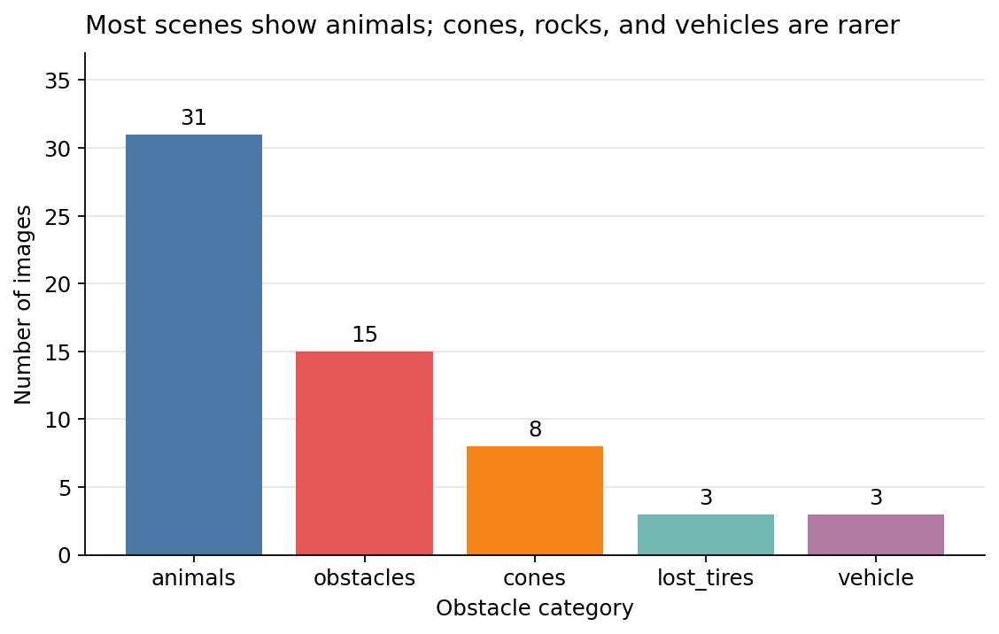

*Figure 1. Images by the prefix of the filename.*

| Category | Images | Median obstacle area | What it represents |
| --- | ---: | ---: | --- |
| animals | 31 | 8.2% | Livestock, wildlife, and herds on or beside the road |
| obstacles | 15 | 6.3% | Rocks, boulders, and barrier-like objects |
| cones | 8 | 1.7% | Traffic cones, often several small objects |
| lost_tires | 3 | 0.7% | A tire loose in the lane, from one dashcam video |
| vehicle | 3 | 10.0% | Unusual vehicles or loads that are not ordinary traffic |

All 60 photographs are 1280×720. That is a 16:9 frame of 921,600 pixels, and the mask uses that same grid. Resolution is therefore not the source of variation. Obstacle size is. The histogram is skewed: most images have a small obstacle, and a few animal scenes have a very large one. The median image is 6.6% obstacle.

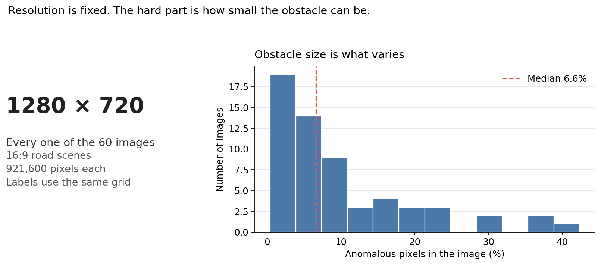

*Figure 2. Left: the resolution shared by every frame. Right: the share of each image that is labelled as obstacle. The dashed line is the median, 6.6%.*

Cones and lost tires are the small-object categories. Animals include both a distant animal and a herd that fills the view.

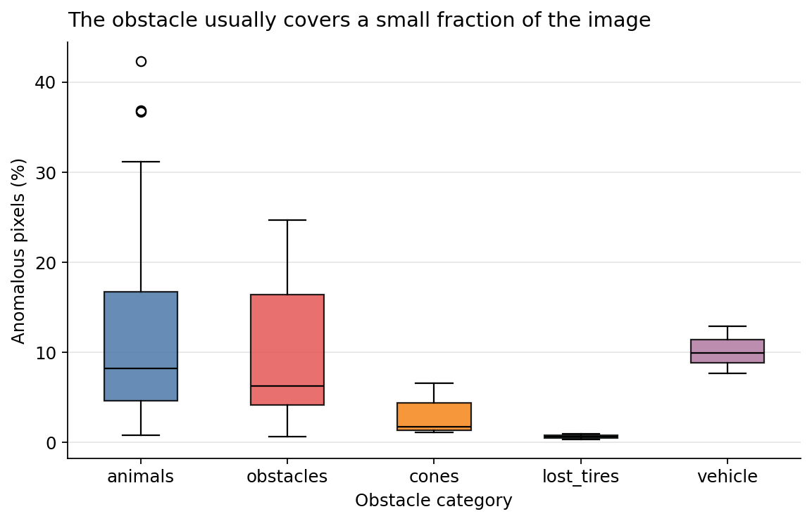

*Figure 3. Obstacle area within each filename category. The line inside each box is the median.*

Because every image has the same number of pixels, the mean image (9.8% obstacle) is the same number as the share of all pixels in the dataset. Background occupies the other 90.2%.

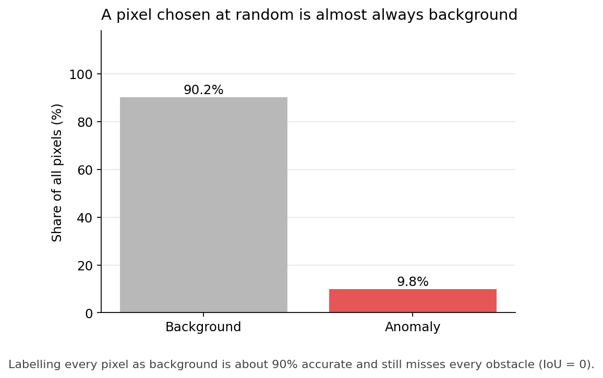

*Figure 4. Class balance over all 55.3 million pixels (60 images × 921,600).*

### 3.3 Correspondence between image and mask

This is the check the brief asks for before any training. The first picture to use is a zoom, because a small obstacle is easy to miss on a full 1280×720 frame.

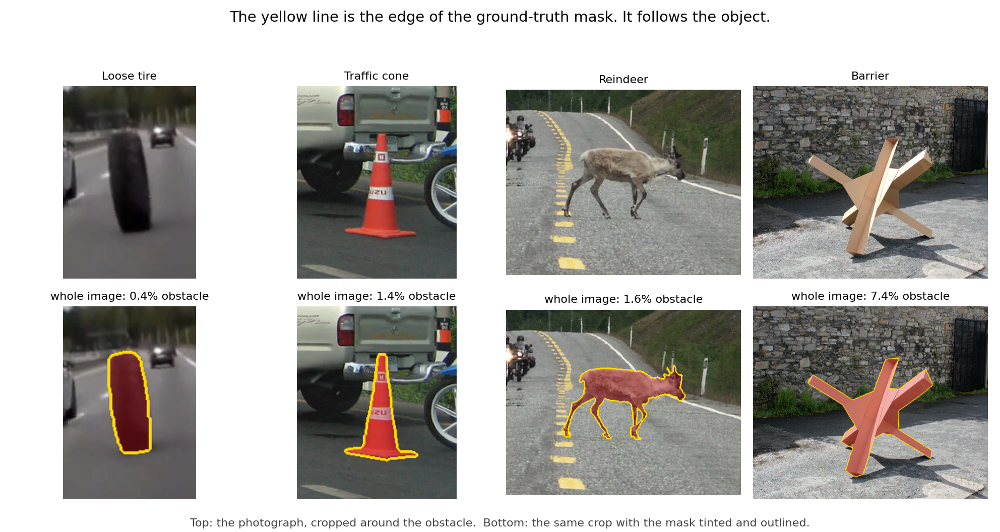

*Figure 11. Four obstacles, cropped so the boundary is readable. The yellow line is the edge of `labels_semantic.png`. It follows the tire, the cone, one reindeer, and the barrier. The percentage under each pair is the obstacle share of the whole photograph, not of the crop: the reindeer frame contains three animals, and only the largest is shown. A mask that had been shifted, or saved at the wrong resolution, would sit beside the object. Thin parts are less tidy. On the cattle in Figure 5, the legs are only partly covered. That is the annotation, and it is visible rather than hidden.*

Figure 5 then shows one scene from each filename category at full frame: the photograph, the mask drawn in red, and the mask laid back on the photograph. The red region sits on the animals, the rocks, the cones, the tire, and the vehicle. The lost-tire row uses `lost_tires08`, where the marked object is the tire in the lane. The red colour is only a display choice. The file on disk is a single-channel mask.

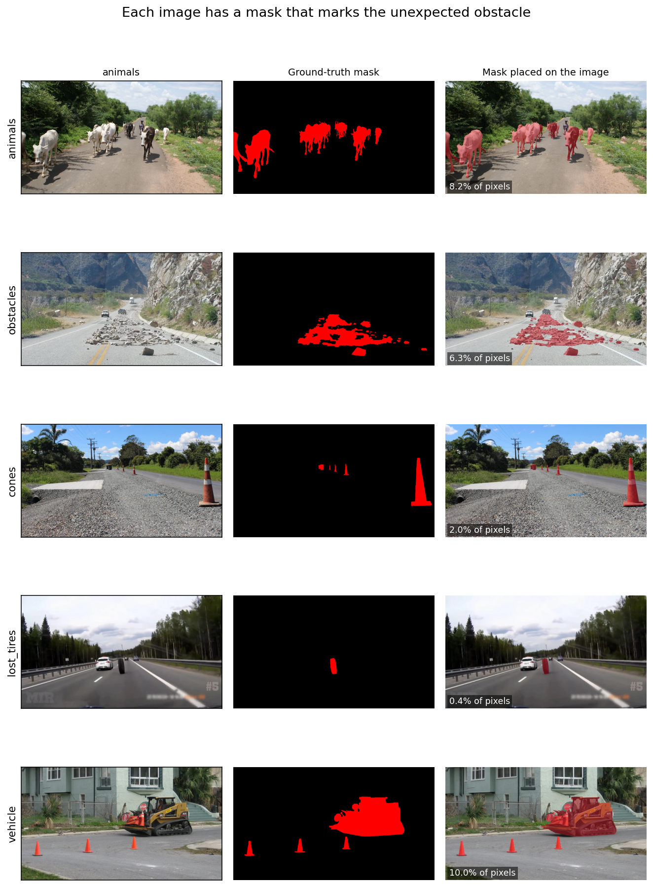

*Figure 5. One scene from each filename category, at the original 1280×720 resolution. The lost-tire scene is `lost_tires08`.*

Figure 6 shows the two ends of the difficulty range. `lost_tires08` is a tire covering 0.37% of the frame (3,453 pixels). `animals09_working_together` covers 42.3% (390,100 pixels). Any later model has to cope with both.

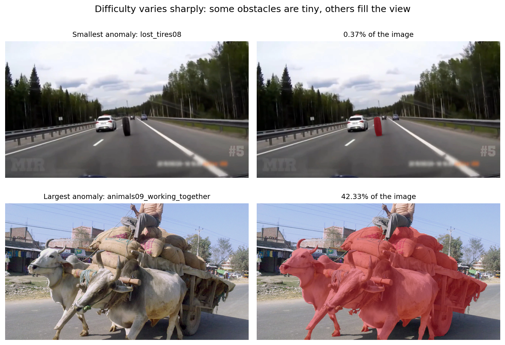

*Figure 6. Smallest and largest annotated regions.*

### 3.4 Instance labels

On the 46 frames that have an instance mask, the instance ids and the semantic mask describe the same pixels: obstacle pixels have an instance id above 0, and background pixels have instance id 0. There were no disagreements. Instance counts run from a single animal up to 31 cones in `cones01`.

Fourteen frames have a semantic mask and no instance mask. The dataset readme explains that some editor files are missing because the labelling was done at another resolution and then rescaled. Those fourteen are listed in `preparation_summary.json` under `frames_without_instance_mask`. The semantic mask is present for every frame, so it is the supervision we keep. Dropping the fourteen frames in order to use instance ids would throw away almost a quarter of an already small set.

### 3.5 Repeated events

Some filenames are several views of one event, and the credits file gives them the same source. Figure 10 shows them with the obstacle tinted.

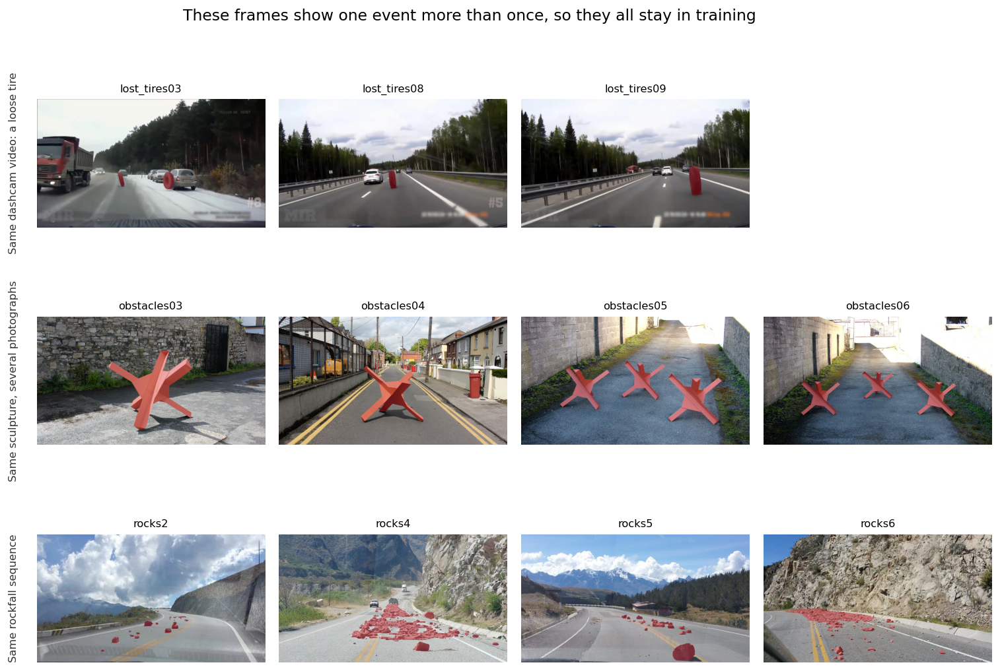

*Figure 10. Three groups kept entirely inside the training set.*

- `lost_tires03`, `lost_tires08`, and `lost_tires09` are frames from one dashcam video. Frames 08 and 09 are moments apart on the same road, with the same tire.
- `obstacles03` to `obstacles06` are photographs of the same cardboard sculpture.
- `obstacles12_rocks2`, `rocks4`, `rocks5`, and `rocks6` are views of one rockfall.

We also compared all 60 images by thumbnail similarity, to see whether any other pair was a hidden duplicate. The highest score joined a reindeer on a Norwegian road with zebras on a desert road: two different scenes that both contain a horizon and an animal. Similarity of the whole frame is not, by itself, evidence of a repeated event. The groups above are repeated events because the pictures and the shared source agree.

### 3.6 Consequences for modelling

- The positive class is rare, and on many images it is a thin object. Later training will need a loss that can see that class, and the reported scores should be the overlap scores in Section 2.3.
- Sixty images is a small training set. The official role of RoadAnomaly was to test models trained elsewhere. Our supervised split is what the brief asks for, and it is small enough that transfer learning is the appropriate next step.
- The test set does not contain a lost tire. All three tire frames are one video, so splitting them would let the model train on one moment and be scored on the next. Tire detection can still be inspected visually on the training frames. It will not be a number in the test table, and that limitation should be stated when results are reported.
- Validation is a little easier than test on median obstacle size (10.0% versus 4.3%). Both sets still run from roughly 1% to above 30%, so neither set is only the easy cases. Section 4 explains how that happened.

---

## 4. Data preparation

### 4.1 From the official mask to a training mask

For each semantic mask we write a new single-channel image:

- official value 0 stays 0 (background);
- official value 2 becomes 255 (obstacle).

The value 255 is a display choice. Training code should treat every pixel greater than 0 as the obstacle. It should not invent a third class at 255.

### 4.2 Making every sample 512×512

A typical segmentation network pools the image several times, often five times, which requires each side to be divisible by 32. The value 512 divides by 32 cleanly (512 / 32 = 16). The original height, 720, does not (720 / 32 = 22.5), so the raw frame is an awkward network input even though the width 1280 would have been acceptable.

Stretching 1280×720 onto a square would make the road taller than it really is and would move the mask relative to the true shape of the object. We keep the aspect ratio instead:

1. Scale both axes by 512 / 1280 = 0.4. The photograph becomes 512×288.
2. Place it on a black 512×512 canvas. The empty bands are 112 pixels at the top and 112 pixels at the bottom.
3. Resize the photograph with bilinear interpolation, and resize the mask with nearest-neighbour interpolation so the mask stays exactly 0 or 255.

Figure 8 shows the same reindeer scene before and after. The animals stay aligned with the red region, and the black bands contain no false obstacle.

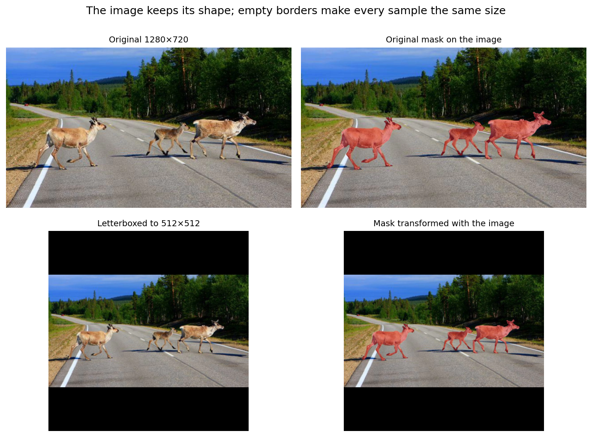

*Figure 8. Top: the original 1280×720 pair. Bottom: the 512×512 pair used for training. The mask is transformed with the same scale and the same padding as the image.*

We then counted obstacle pixels in every prepared mask. The smallest surviving obstacle has 552 pixels. No annotation disappeared in the resize.

### 4.3 The split

Target sizes are 70% / 15% / 15%, which on 60 images is 42 / 9 / 9. The assignment follows three rules.

1. **Keep a repeated event in one split.** The 11 frames in Figure 10 all go to training. Putting the three tire frames into the 9-image test set would make one video a third of the test score.
2. **Stratify the remaining 49 frames by filename category**, with these hold-out counts: animals 5 validation and 5 test, cones 2 and 2, obstacles 1 and 1, vehicle 1 and 1. Lost tires have no frame left outside the repeated-event group.
3. **Spread obstacle sizes.** Within a category the frames are ranked from the smallest obstacle to the largest. Hold-out positions are spaced evenly along that ranking, then alternate between test and validation, starting with test on the smaller end. Both hold-out sets therefore contain small and large objects. Validation receives the larger member of each pair, which is why its median (10.0%) sits above the test median (4.3%).

The rule is deterministic. Re-running the script produces the same split. No scene group appears in more than one split; the audit count of groups that cross a split is 0.

| Split | Images | Share | Obstacle area: minimum | median | maximum |
| --- | ---: | ---: | ---: | ---: | ---: |
| train | 42 | 70% | 0.37% | 6.5% | 36.8% |
| val | 9 | 15% | 1.4% | 10.0% | 42.3% |
| test | 9 | 15% | 0.8% | 4.3% | 31.2% |

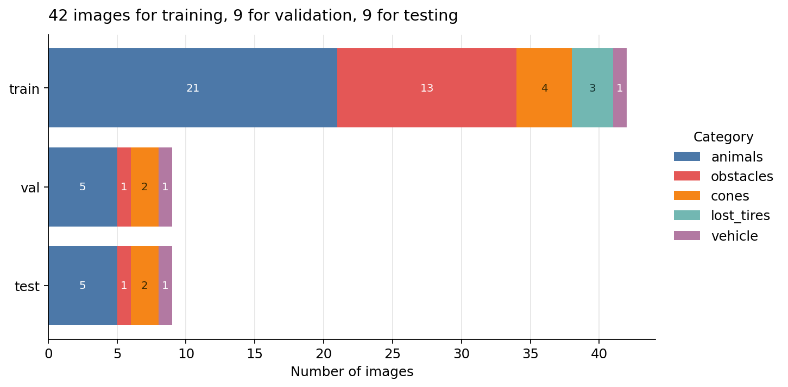

*Figure 7. Training holds every category. Validation and test hold animals, obstacles, cones, and vehicles. Lost tires stay in training for the reason in Figure 10.*

|  | animals | obstacles | cones | lost_tires | vehicle | Total |
| --- | ---: | ---: | ---: | ---: | ---: | ---: |
| train | 21 | 13 | 4 | 3 | 1 | 42 |
| val | 5 | 1 | 2 | 0 | 1 | 9 |
| test | 5 | 1 | 2 | 0 | 1 | 9 |

The 18 hold-out images are listed here so the split can be checked without opening the code. Obstacle area is the share of the original 1280×720 frame. A dash in the instance column means that frame has no instance file.

**Test**

| Category | Frame | Obstacle area | Instances |
| --- | --- | ---: | ---: |
| animals | animals02_Zagori_On_the_road_to_Papigko | 0.8% | 1 |
| animals | animals16_Donkeys_of_Morocco | 31.2% | 1 |
| animals | animals20_Marcassin_Conchiglio | 4.3% | 1 |
| animals | animals25_jablonna_dziki | 13.5% | — |
| animals | animals29_Zebra_Crossing_Abbey_Road_Style | 7.0% | 4 |
| cones | cones01_Beeston_MMB_A6_Middle_Street | 4.3% | 31 |
| cones | cones05_Corner_of_Kingsley_Park | 1.1% | 8 |
| obstacles | obstacles08_boulder2 | 1.4% | — |
| vehicle | vehicle03_Fuhrwerke_in_China | 7.7% | 4 |

**Validation**

| Category | Frame | Obstacle area | Instances |
| --- | --- | ---: | ---: |
| animals | animals04_17_animal_casualties_so_far_in_2006 | 6.6% | 3 |
| animals | animals09_working_together | 42.3% | — |
| animals | animals13_jeune_bovin_sur_la_route | 1.6% | 3 |
| animals | animals14_Dekemhare_Road | 10.0% | 8 |
| animals | animals27_wildlife_bear | 18.2% | 1 |
| cones | cones02_Broadmoor_Manhole_Cones | 6.6% | 5 |
| cones | cones07 | 1.4% | — |
| obstacles | obstacles07_czech_hedgehog | 24.7% | — |
| vehicle | vehicle01_man_carrying_dry_grass_on_bicycle | 13.0% | 1 |

Figure 9 shows every prepared image, with the obstacle tinted and a coloured border for the split: green for test, orange for validation, blue for training.

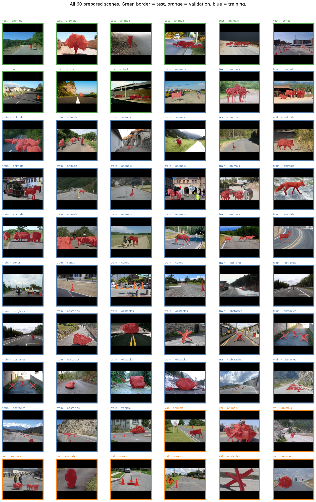

*Figure 9. The prepared set. Borders mark the split.*

### 4.4 Files written for the next stage

```
data/processed/
  train/images/*.png     train/masks/*.png
  val/images/*.png       val/masks/*.png
  test/images/*.png      test/masks/*.png
  split_manifest.csv
  preparation_summary.json
```

Each row of `split_manifest.csv` records the original size, the scale 0.4, the padding, the obstacle pixel count before and after resizing, and the paths of the written files. `reports/tables/split_assignment.csv` is the same assignment joined to the exploration fields.

### 4.5 Checks that the preparation passed

| Check | Result |
| --- | --- |
| Listed images found, each with a semantic mask | 60 / 60 |
| Image size equals mask size | 60 / 60, all 1280×720 |
| Mask values | Only 0 and 2 |
| Obstacle present in every original mask | Yes, minimum 3,453 pixels |
| Instance mask agrees with semantic mask, where an instance mask exists | 46 / 46, zero disagreements |
| Scene groups that appear in two splits | 0 |
| Prepared samples | 512×512, mask values 0 and 255 only |
| Obstacle present after resizing | Yes, minimum 552 pixels |
| Split sizes | 42 train, 9 validation, 9 test |

---

## 5. Conclusions of this stage

RoadAnomaly is a small, fully paired segmentation problem: 60 road scenes, one mask each, two classes, and a strong imbalance toward background. The masks line up with the photographs. The variation that matters is the obstacle's type and its area, from a tire of a few thousand pixels to a herd covering almost half the frame.

The prepared data respect that structure. Repeated views of one event stay in training. Validation and test both contain animals, obstacles, cones, and vehicles, and both contain small and large obstacles. Images and masks share a 512×512 canvas that preserves the 16:9 frame.

The next stage can train a segmentation model on `data/processed/train`, watch it on `val`, and report precision, recall, F1, IoU, and Dice on `test`. Transfer learning is the appropriate starting point because 42 training images will not carry a deep network on their own. The lost-tire category will need a visual check rather than a test-set number, and any comparison with Lis et al. (2019) needs the paper's protocol: train without these 60 images, then test on all of them.

---

## References

Lis, K., Nakka, K., Fua, P., and Salzmann, M. (2019). Detecting the Unexpected via Image Resynthesis. *International Conference on Computer Vision (ICCV).*

Dataset notes used here: `readme.md` (directory layout and the encoding background = 0, anomaly = 2) and `credits.txt` (shared sources for the tire video, the cardboard sculpture, and the rock sequence).
